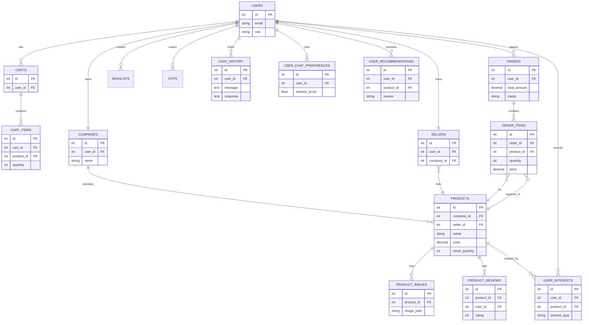

# Vendora Database ER Diagram

This file presents a readable ER diagram and table summaries for the Vendora project. The original Mermaid source is in `docs/er_diagram.mmd` and the SQL DDL is in `docs/schema.sql`.

## Key Entities & Relationships

- `User`: central actor (roles: admin, company, seller, retailer, customer).
- `Company`: one-to-one with a `User` (company owner). Has many `Seller` and `Product` records.
- `Seller`: one-to-one with a `User`, belongs to a `Company` and may list `Product`s.
- `Product`: belongs to `Company` and optionally a `Seller`; has images, reviews, wishlist entries, and order items.
- `Cart` / `CartItem`: one-to-one `Cart` per `User`, with multiple `CartItem`s.
- `Order` / `OrderItem`: `Order` placed by `User`, contains `OrderItem`s referencing `Product`s.
- AI tables: `ai_chat_history`, `user_product_interests`, `user_chat_preferences`, `user_recommendations`.

## Mermaid (ER diagram)

## Where to find the schema
- The SQL DDL export is in `docs/schema.sql` — use it as a starting point for migrations or DB review.
%% Vendora Database ER Diagram (Mermaid)
erDiagram
    USERS ||--o{ ORDERS : places
    USERS ||--o{ CARTS : has
    CARTS ||--o{ CART_ITEMS : contains
    USERS ||--o{ WISHLISTS : creates
    USERS ||--o{ OTPS : issues
    USERS ||--|| COMPANIES : owns
    USERS ||--|| SELLERS : owns
    COMPANIES ||--o{ PRODUCTS : provides
    SELLERS }o--|| PRODUCTS : lists
    PRODUCTS ||--o{ PRODUCT_IMAGES : has
    PRODUCTS ||--o{ PRODUCT_REVIEWS : has
    PRODUCTS ||--o{ ORDER_ITEMS : appears_in
    ORDERS ||--o{ ORDER_ITEMS : contains
    ORDER_ITEMS }o--|| PRODUCTS : for
    PRODUCTS ||--o{ USER_INTERESTS : tracked_by
    USERS ||--o{ USER_INTERESTS : records
    USERS ||--o{ CHAT_HISTORY : chats
    USERS ||--o{ USER_CHAT_PREFERENCES : sets
    USERS ||--o{ USER_RECOMMENDATIONS : receives

    USERS {
      int id PK
      string email
      string role
    }
    COMPANIES {
      int id PK
      int user_id FK
      string name
    }
    SELLERS {
      int id PK
      int user_id FK
      int company_id FK
    }
    PRODUCTS {
      int id PK
      int company_id FK
      int seller_id FK
      string name
      decimal price
      int stock_quantity
    }
    PRODUCT_IMAGES {
      int id PK
      int product_id FK
      string image_path
    }
    PRODUCT_REVIEWS {
      int id PK
      int product_id FK
      int user_id FK
      int rating
    }
    CARTS {
      int id PK
      int user_id FK
    }
    CART_ITEMS {
      int id PK
      int cart_id FK
      int product_id FK
      int quantity
    }
    ORDERS {
      int id PK
      int user_id FK
      decimal total_amount
      string status
    }
    ORDER_ITEMS {
      int id PK
      int order_id FK
      int product_id FK
      int quantity
      decimal price
    }
    USER_INTERESTS {
      int id PK
      int user_id FK
      int product_id FK
      string interest_type
    }
    CHAT_HISTORY {
      int id PK
      int user_id FK
      text message
      text response
    }
    USER_CHAT_PREFERENCES {
      int id PK
      int user_id FK
      float interest_score
    }
    USER_RECOMMENDATIONS {
      int id PK
      int user_id FK
      int product_id FK
      string reason
    }
