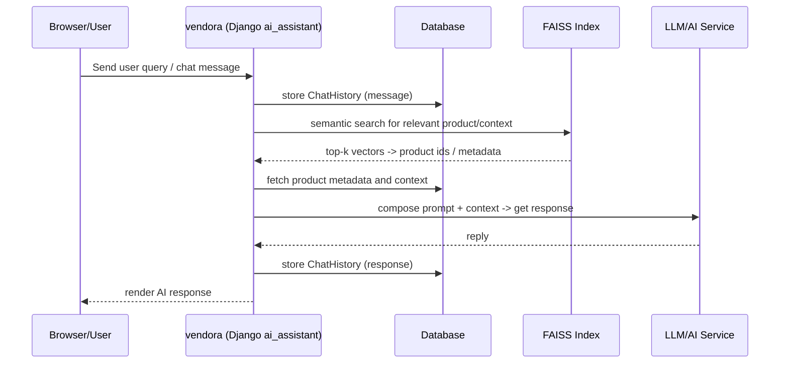

# AI Query / Chat Sequence (Readable)

This document explains how the `ai_assistant` app handles user queries and uses FAISS + stored data to provide context-aware responses.

## Plain steps

1. User sends a chat message to the AI endpoint.
2. Server stores the incoming message in `ai_chat_history`.
3. Server queries the FAISS index (`ai_embeddings/product_index.faiss`) for semantically similar product/context vectors.
4. Server fetches product metadata and other context from the database.
5. Server composes a prompt with the context and sends it to the LLM/AI service.
6. Server receives the response, stores it in `ai_chat_history`, and returns it to the user.

## Mermaid (sequence)

