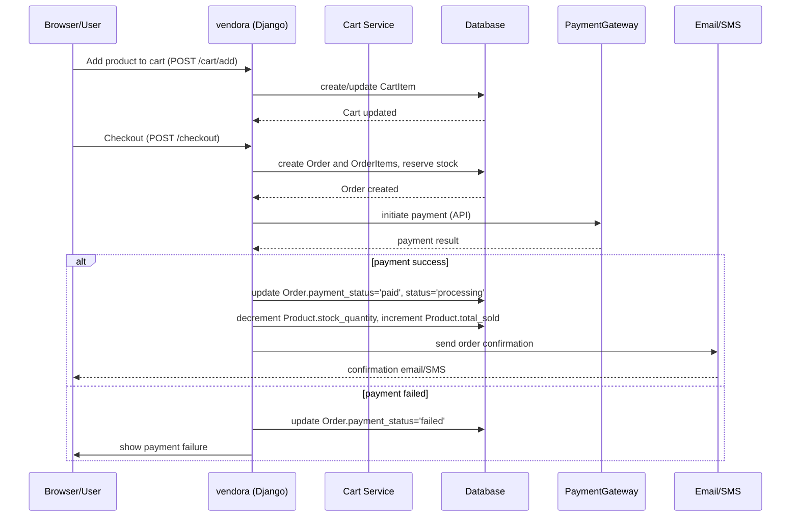

# Checkout Sequence (Readable)

This file explains the checkout flow in plain steps and includes the Mermaid sequence diagram.

## Plain steps

1. User adds product(s) to their cart via the web UI (`/cart/add`).
2. The server updates or creates `CartItem` records in the database.
3. User submits checkout (`/checkout`).
4. Server creates an `Order` and corresponding `OrderItem` rows, and may reserve stock.
5. Server calls the payment gateway API to process payment.
6. On success: update `Order` status to paid/processing, decrement product stock, send confirmation email/SMS.
7. On failure: set payment status to failed and notify the user.

## Mermaid (sequence)

