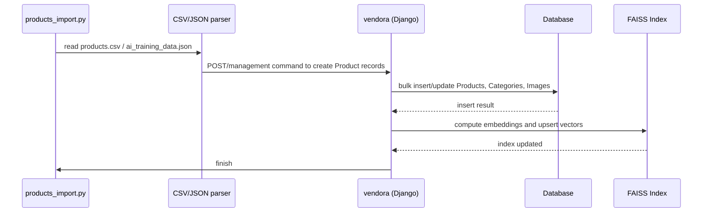

# Product Import Sequence (Readable)

This document explains how `products_import.py` or related scripts populate the database and build embeddings.

## Plain steps

1. The import script reads `products.csv` and/or `ai_training_data.json`.
2. Parsed records are sent to the Django app via management command or direct ORM calls.
3. The app inserts/updates `Category`, `Product`, `ProductImage`, etc. in the DB.
4. After products are persisted, the app computes vector embeddings for product text/images and upserts them into `ai_embeddings/product_index.faiss`.

## Mermaid (sequence)

